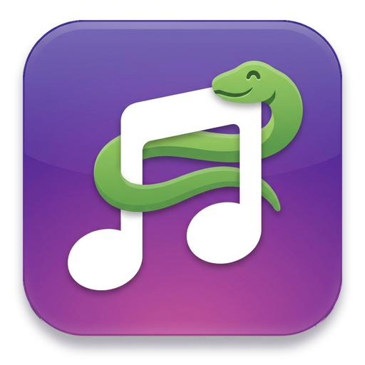
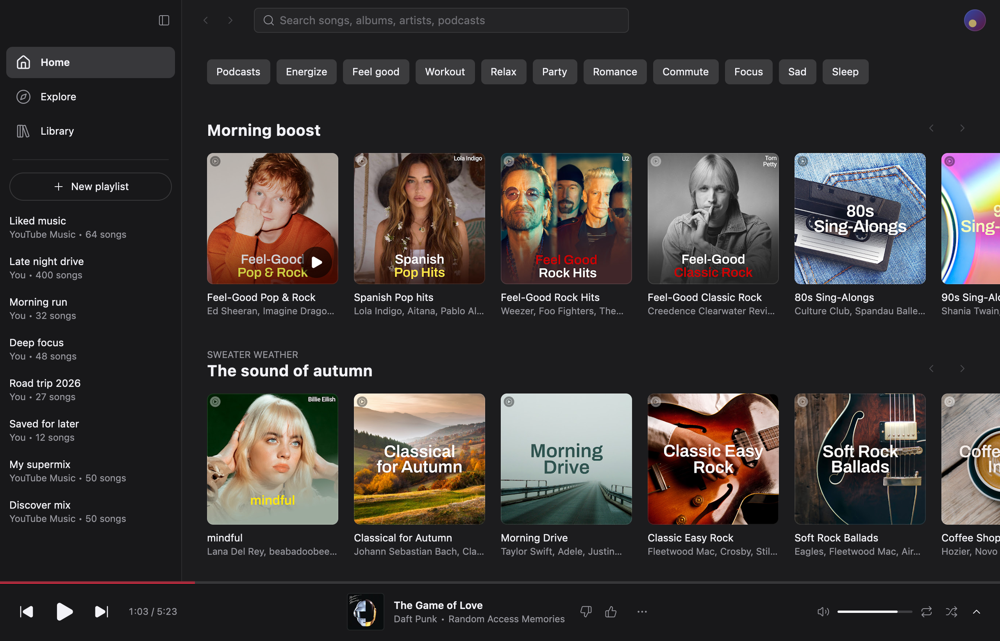
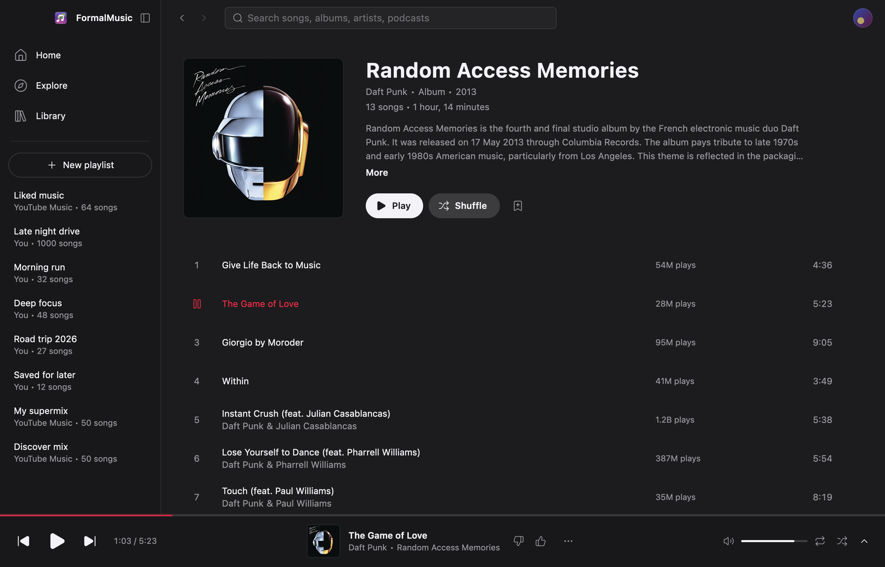
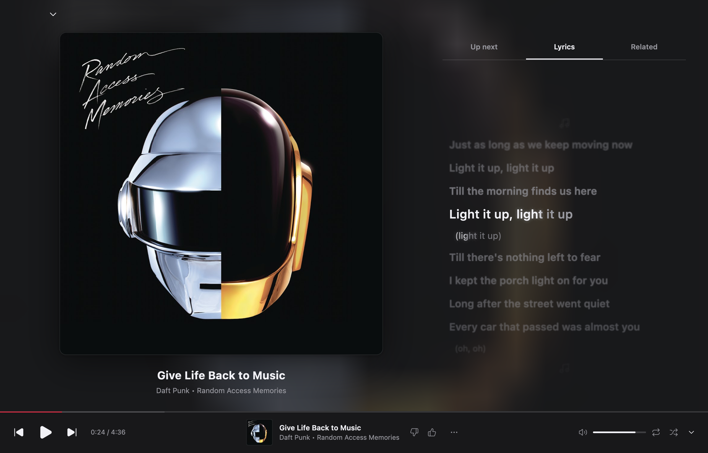
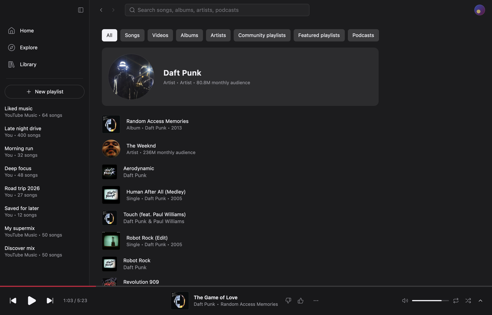
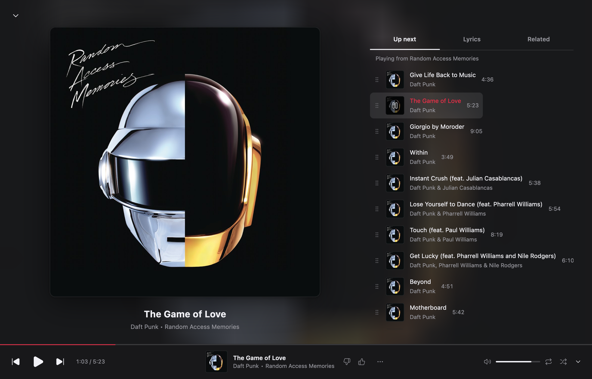

<p align="center"></p>

# FormalMusic

YouTube Music on Linux, macOS and Windows. A native Rust client on
[NativeDesktop](https://github.com/FormalSnake/NativeDesktop) (AppKit on macOS, GPUI
elsewhere) on top of the [Kopuz](https://github.com/Kopuz-org/kopuz) daemon, with
synced lyrics and Apple Music motion artwork.



```
┌──────────────────────┐     gRPC      ┌────────────────────────────────┐
│ formalmusic (nd)     │ ────────────▶ │ kopuzd, or the Kopuz app       │
│ AppKit / GPUI window │ ◀──────────── │ YouTube Music source, streams, │
└──────────────────────┘  unix socket  │ audio engine, queue, MPRIS     │
                                       └────────────────────────────────┘
```

The daemon owns playback, so music keeps going with the window closed and media
keys work through MPRIS. The window paints from its last state before the
daemon answers, pages you have seen open in the frame you click, and it idles
at 0% CPU.

| | |
|---|---|
|  |  |
|  |  |

## Features

- Home with mood chips, Explore (new releases, charts, moods and genres),
  search with suggestions and filters, album, artist, playlist and podcast pages.
- Library: playlists, songs, albums, artists, subscriptions, podcasts, uploads,
  liked music and history. Likes, subscriptions and playlist editing.
- Queue with drag to reorder, play next, radio that keeps itself topped up,
  shuffle and repeat. Gapless playback, optional crossfade, loudness
  normalisation from YouTube's own values.
- Premium streams (Opus up to 256 kbps) when the account has Premium.
- Word-synced lyrics from Apple Music, LRCLIB or YouTube Music, whichever has
  the best timing, drawn in the Apple Music style.
- Brand accounts, and plays reported to YouTube so History and recommendations
  stay current.
- Apple Music motion artwork for albums that have it.
- Colours follow [matugen](https://github.com/InioX/matugen) live.

Not yet on Kopuz: the music video picture, Premium detection and per-service
scrobbling switches (`PLAN.md` lists what Kopuz still lacks).

## Install

### Nix

```
nix run github:FormalSnake/formalmusic
```

Home Manager:

```nix
{
  inputs.formalmusic = {
    url = "github:FormalSnake/formalmusic";
    inputs.nixpkgs.follows = "nixpkgs";
  };

  # in your home-manager configuration
  imports = [ inputs.formalmusic.homeModules.default ];

  programs.formalmusic = {
    enable = true;
    daemon = true;                     # kopuzd as a systemd user service
    settings.playback.crossfade_ms = 3000;  # any key of config.toml, typed
  };
}
```

This installs the app, the desktop entry and icon, and runs Kopuz's daemon,
pinned to the release the app's Kopuz client crates come from (v0.22.0). kopuzd and the
Kopuz desktop app own one library and cannot run at the same time: if you use
the Kopuz app, set `daemon = false` and FormalMusic attaches to the app.
`overlays.default` adds `pkgs.formalmusic` and `pkgs.kopuz`.

### From source

Needs a recent stable Rust, `ffmpeg` on `PATH`, Kopuz's `kopuzd` (v0.22.0, the
release `Cargo.toml` pins, or the Kopuz app running), and on Linux Vulkan,
`libxkbcommon`, `wayland`, `vulkan-loader`, `fontconfig` and `freetype`.

```
git clone https://github.com/FormalSnake/formalmusic
cd formalmusic
cargo build --release -p formalmusic
```

The app starts `kopuzd` from `PATH` when nothing answers on Kopuz's socket.

## Signing in

Kopuz signs in: pick a browser profile that is already signed in to YouTube
Music, let it open your browser at Google's sign-in page, or paste the
`Cookie` request header of a signed-in music.youtube.com tab. Kopuz keeps the
session. Without signing in, everything that doesn't need an account works.

`FORMALMUSIC_DEMO=1 formalmusic` runs on a made-up catalog with no daemon.

## Scrobbling

Settings (`Ctrl+,`, or the account menu) connects Last.fm and ListenBrainz
through Kopuz, which scrobbles. Last.fm signs every call with an API account,
so you need your own: create one at
[last.fm/api/account/create](https://www.last.fm/api/account/create) (no
callback URL), paste its API key and shared secret into Settings, then allow
access in the browser. ListenBrainz connects from a browser profile or the
user token on [listenbrainz.org/settings](https://listenbrainz.org/settings/).

## Configuration

`~/.config/formalmusic/config.toml` (`~/Library/Application Support/formalmusic`
on macOS) holds every setting; the Settings window writes it, the window pushes
the playback keys into Kopuz's settings on connect and on every change, and
Home Manager can own any key
(`programs.formalmusic.settings`, typed options generated from the schema in
`crates/api/src/settings.rs`). A `config.json` and `daemon.json` from before are
imported once.

```toml
[playback]
quality = "high"
crossfade_ms = 3000

[privacy]
report_history = false
```

`~/.config/formalmusic/theme.json` is NativeDesktop's matugen file (Material
roles under `colors`, from nd's template) and is reloaded live.

Environment overrides: `FORMALMUSIC_KOPUZ_SOCKET`, `FORMALMUSIC_TRACE=1`
(startup and navigation timings). A bar widget drives playback through Kopuz
itself, with `kopuzctl toggle` or `grpcurl`.

## Keyboard

| | |
|---|---|
| `Space` / `;` | play or pause |
| `J` / `K`, `Shift+N` / `Shift+P`, `N` / `P` | next / previous |
| `H` / `L`, `Shift+←` / `Shift+→` | back / forward 10 seconds |
| `Shift+H` / `Shift+L` | back / forward 1 second |
| `=` / `-`, `Shift+↑` / `Shift+↓` | volume |
| `M` | mute |
| `+` / `_` | like / dislike |
| `S` / `R` | shuffle / repeat |
| `G H`, `G E`, `G L`, `G ,` | Home, Explore, Library, Settings |
| `/`, `Ctrl+F` | search |
| `Q` | queue |
| `F` | expanded player |
| `?` | all shortcuts |
| `Alt+←` / `Alt+→` | back / forward |
| `Ctrl+,` | settings |

`Cmd` on macOS.

## Development

```
nix develop
FORMALMUSIC_DEMO=1 cargo run --release -p formalmusic   # made-up catalog
cargo test --workspace
nix build .#formalmusic                                 # Linux package
```

A weekly systemd timer on the maintainer's machine runs Claude Code headless
with `maintenance/weekly.md` as the prompt: it moves the Kopuz pin, nixpkgs and
the crates, runs the checks, repairs what broke and ships the result as a PR.

`crates/api` is the app's model and settings, `crates/core` the window's store
and its bridge to Kopuz (`src/kopuz`), `crates/extras` Apple Music motion
artwork, and `crates/app` the window, on NativeDesktop, which is expected as a
sibling checkout (`../nativedesktop`). `PLAN.md` has the architecture and the
speed budget.

## License

[MIT](LICENSE). Not affiliated with YouTube, Google or Apple.
